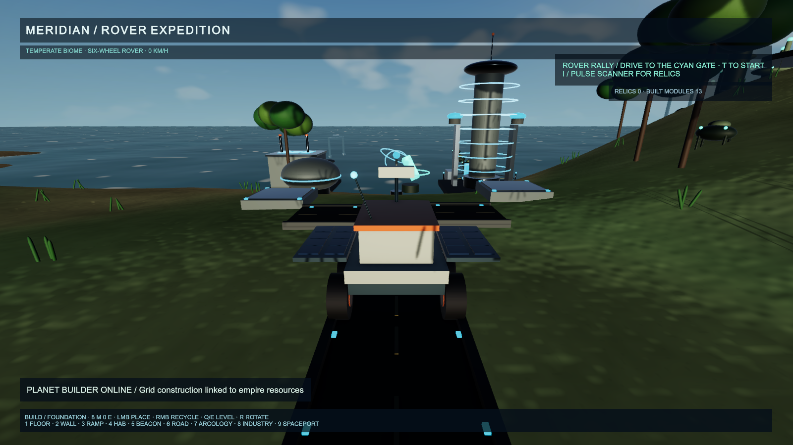

# Orbit Dominion



A playable Unity 3D exploration, creative sandbox, civilization and conquest prototype. Personally fly through three star systems, discover twelve worlds, drive a rover across distinct surfaces, construct persistent local bases, race planet-specific courses, recover relics, develop colonies, defend against fleets and conquer developed planets.

The three systems have stellar centers and moving planets. Their gently elliptical, accelerated orbits use the Kepler period relationship: inner planets complete a circuit sooner than outer planets. Moons revolve around their planets, faint paths show each orbit, and the local star sets the light direction. Navigation, fleets, orbital defenses, landing and saves follow the moving worlds; star proximity blocks pulse travel. Older full-flight saves open at the original orbital epoch.

**Source prototype:** build the Windows player using the Unity steps below. Generated binaries and personal saves are not included. After building, run `Builds/Windows/OrbitDominion.exe` with its adjacent `_Data` folder and DLLs. The game restores a valid local save when available.

## Unity project
- Editor: **Unity 6000.6.0f1**, the installed compatible Unity 6.6 Supported release, with Windows Build Support.
- URP 17.6.0, Input System 1.19.0, Test Framework 1.8.0 and UI Toolkit.
- Open this folder through Unity Hub. Run **Tools → Orbit Dominion → Setup Prototype**, then open `Assets/OrbitDominion/Scenes/Solace.unity` and press Play.
- Setup is idempotent and preserves configuration and existing input bindings. No manual Inspector wiring, paid assets, accounts or external keys are required.

## Controls
| Input | Action |
|---|---|
| W / S | Forward / reverse thrust |
| Mouse / arrow keys | Pitch and yaw |
| Q / E | Roll |
| Shift + W | Boost |
| Space | Brake, cancel pulse |
| P | Physical pulse travel; blocked near planets or during combat |
| Hold F | Scan selected detected world within 650 m, pulse off |
| Tab | Cycle detected/known planetary contacts |
| J | Exploration journal |
| C | Establish colony within 220 m on a scanned viable unclaimed world |
| B | Manage selected owned world; construction continues after resuming flight |
| LMB (hold) | Primary energy weapon |
| R | Cycle nearby hostile combat targets |
| M | Sector chart and navigation signals; never teleports |
| Hold I | Investigate an anomaly within 180 m for four seconds |
| L | Land on a nearby scanned world while moving slowly; launch back to the same orbit from its surface |
| Hold G | Capture scanned, cleared occupied planet within 220 m for twelve seconds |
| H | Activate protection for selected/managed owned world |
| F5 | Save full flight, also while paused |
| Escape | Pause/resume or close active journal/chart/management |

Distances are from the planetary surface unless referring to a signal or ship. Menus pause simulation and release the cursor. Use the sector chart's **Follow current objective** button to return to tutorial guidance after selecting another navigation destination.

## Planetary surface expeditions

Approach any scanned planet within 320 m of its surface, brake below 35 m/s and press **L**. Hostile worlds require clearing orbital defenses first. You arrive on foot beside the local ship's airlock, with a parked six-wheel rover nearby. **WASD** walks relative to the third-person camera, **mouse** rotates the view and **Shift** runs. Press **E** near the rover to drive; **E** exits once it has stopped, checking for safe ground. In the rover, **W/S** accelerate, brake or reverse, **A/D** steer and **Shift** boosts. Walk back to the ship's lit airlock and press **E** to board and return to the original orbit; **L** remains an immediate recall shortcut. **I** scans for relics, **F** collects, **Esc** pauses and **F5** saves in either mode. Walking and the follow camera respect surface obstacles. On Elysia, explore the landing deck on foot and use the amphibious rover for open water; unsafe water exits are rejected.

On an owned planet press **B** for the planet builder. Keys **1–9** select a foundation, wall, ramp, habitat, beacon, road, arcology, industrial complex or spaceport; **Q/E** change vertical grid level, **R** rotates, **LMB** places and **RMB** recycles the targeted module for half its cost. Construction uses empire minerals and energy. Each module has a real footprint, so large structures cannot overlap neighboring lots. Foundations, ramps, roads and spaceports are driveable; walls and occupied buildings block the rover. Roads include curbs, markings and reflectors, while the larger buildings include lit floors, tanks, pipes, collectors, service areas and navigation lights. Press **T** at the highlighted cyan start gate to begin that planet's seven-gate Rover Rally. The first finish and later personal records grant empire resources.

Each of the twelve worlds has a repeatable explorable landing region with its own terrain, palette and points of interest. Mixed worlds have rolling terrain, shores, shallow water, distant sea and a layered cloud atmosphere. The terrain shader combines procedural macro breakup with seamless high-frequency PBR albedo and normal detail, slope minerals, wet shoreline response, ambient light, shadowed starlight and a local reflection probe. Water uses displaced waves, changing normals, Fresnel reflection, specular highlights and shoreline foam. Temperate worlds have alpha-cutout leafy groves, meadow cover and grazing fauna; Ithaca also has a neutral inhabited district with radial roads and street lighting. Roads, construction panels, rover parts, ships and colony structures use textured metal, asphalt or terrain materials. Elysia is an open-water world with pelagic life. Desert, frozen, volcanic, rocky and toxic worlds use different coast colors, dunes, ice needles, lava, mineral spires or fungal groves. Developed planets show inhabited habitats and citizens on the surface. Space uses animated stellar photospheres and additive coronas rather than emissive plain spheres.

The surface-model refinement replaces the basic rover body with bevelled panels, framed glazing, rocker/bogie arms, detailed rims and treads, cameras and a sampling tool. All nine construction modules share an architectural kit with airlocks, floor windows, roof equipment and industrial services. Trees have tapered trunks and roots; rocks and ice use irregular formation meshes, and ground cover uses bent blades. Saved building lots clear overlapping trees and outcrops, including after loading; recycling restores the scenery. Local daylight, diffuse sky fill and material tones make the geometry more readable. Static details combine by material and generated meshes are explicitly released. The 2026-11-19 Windows build passed 59 EditMode and 38 PlayMode tests and was inspected in visible rover, settlement and biome captures. This remains detailed procedural art rather than complete photorealism.

Six hidden relics are placed deterministically on each world. A recovered relic grants 60 minerals and 40 energy once. Relics, active planet, exploration mode, person and parked rover poses, built modules and per-planet rally records persist in the validated `flight-v2.json` save. Older saves remain compatible and resume in the rover when the optional walking fields are absent. Movement speed and an unfinished rally reset on reload. Building remains available on foot; Q/E adjust height while the builder is open. Rally starts require the rover, and new modules cannot obstruct the ship's landing zone. The surface is a detailed local region rather than a seamless trip around a full planet.

## Guided journey and sandbox

The astronaut carries an **ARC-18 energy rifle**: **RMB** aims over the shoulder, **LMB** fires and **R** recharges the eighteen-round magazine. Orange practice targets beside Meridian's landing site let you learn the controls immediately. The reticle confirms hits; the suit panel shows shield, health and ammunition. Buildings and terrain stop shots, and a muzzle obstruction prevents shooting around cover merely because the camera can see a target. Shooting is disabled while driving, sprinting, paused or building. Shields recharge after five quiet seconds; a critically injured explorer is rescued at the ship with world progress preserved. Suit wounds, ammunition and defeated guards survive saving and loading.

Hostile surface settlements contain **Varkesh sentries** with clear red markers, alert states and health. They patrol and return fire when they see you; use cover. **Ithacan civilians** have a distinct appearance and neutral green labels, and civilians are protected from player fire. Orbital conquest now shows remaining defenders, approach distance and the next action. You can still hold **G** in a cleared orbit, or land, defeat the surface sentries and hold **G** within four metres of the marked **command terminal**. Orbital defenses and planetary protection must be cleared for either route. The contextual objective and capture percentage explain progress; captured civilian buildings survive and **B** opens development on your new world. The astronaut's anatomical proportions, rounded suit, two-handed rifle grips, stride transitions, foot placement, recoil and recharge poses replace the earlier block model; these are procedural assets and animation, not a claim of complete photorealism.

The 27-stage guide follows completed game state, not just button presses. Start at Meridian, reach the beacon, scan Aurelia II, establish a colony, build energy production, upgrade the settlement and add orbital defense. Follow the distant signal into the Veil Frontier, investigate ancient technology and observe the Ithacan civilization. Fight the arriving Corsair interceptors, then return to defend your colony against a fleet launched from enemy territory.

Review protection, repair at Meridian and travel into Cinder Reach. Scan an enemy colony, clear local fighters, satellites and orbital command, then hold G in orbit to take ownership. Civilian infrastructure survives; military capacity must be rebuilt. The guide recognizes work done early and survives rescue/reload. Afterward the simulation continues as a sandbox.

**Victory:** own at least **8 of 12 worlds for 60 continuous seconds**. Dropping below eight resets the countdown. Winning records the achievement and allows continued exploration and development.

## Economy and development
Start with 520 minerals / 420 energy plus home production. Colony deployment costs 180 / 120 and takes twelve seconds. Leaving orbit or engaging pulse pauses paid deployment; returning resumes it. Habitability must be at least 25%; the frozen initial world is intentionally unsuitable.

| Building | First-level cost M / E | Effect |
|---|---|---|
| Mining complex | 90 / 45 | Mineral production, visible industry |
| Energy complex | 70 / 60 | Energy production, collectors |
| Settlement | 100 / 80 | Cities, traffic, development, build slots |
| Defense satellite | 130 / 100 | An actual orbiting armed satellite per level |
| Orbital station | 180 / 140 | Visible station, traffic, +10% production per level |

Buildings have three levels. Upgrade cost and duration scale with the new level; base duration is eighteen seconds. One project runs per world. Settlement levels unlock 3–5 slots; upgrading an existing type uses its existing slot. Construction continues remotely while flying. Survey resource values modify income. The planetary defense rating is installed capacity, including temporarily disabled satellites.

## Combat, diplomacy and war
The player has 100 shield / 120 hull. Shields regenerate after five quiet seconds. LMB fires within 750 m; selected targets within five degrees receive aiming assistance. Planets, asteroids, structures and intervening units block beams. R selects combat targets independently of planetary Tab selection. Enemy guns turn toward their targets rather than instantly facing them.

Neutral Ithacan defenses warn and retaliate only after aggression. The Cinder Dominion produces resources, develops owned worlds, pays for small fleets, physically travels from enemy territory, attacks colonies and occupies undefended planets. Early tutorial pacing delays attacks on the first colony while allowing enemy expansion elsewhere. Nearby orbital satellites participate in defense; destroyed Union satellites repair after combat has subsided.

Capture requires a scan, defeated local military, pulse off and uninterrupted time in orbit. Releasing G or leaving range resets capture progress. Ownership shifts production to the new faction while preserving civilian buildings. Meridian can never be permanently lost. A destroyed player is rescued at home after four seconds with restored health and temporary protection; empire progress survives. A living ship repairs after three quiet seconds near Meridian.

## Planetary protection
H or the colony management button spends **160 energy** for **45 seconds** of protection. A **180-second cooldown starts after expiration**. Protection cannot stack or activate within fifteen seconds of an attack. It blocks capture and infrastructure damage, and protected defense weapons stop firing. It does not make the player's ship invulnerable. All values are configurable.

## Full saves and migration
The normal save is `flight-v2.json` under `Application.persistentDataPath`, normally `%USERPROFILE%\AppData\LocalLow\Orbit Dominion\Orbit Dominion` on Windows.

It retains galaxy seed/IDs, discovery, ownership, buildings/resources/work, ship position/rotation/velocity/pulse/vitals, combat entities, AI resources/timers, fleets/destinations, protection/cooldowns/capture, investigation rewards/progress, tutorial flags and victory. No GameObject references are serialized. There is no offline income.

Autosave runs every ten simulation seconds, on relevant actions and normal exit; F5 and menu buttons save manually. A validated temporary file atomically replaces the primary and keeps `.bak`. Invalid files are preserved and cannot be silently overwritten. A valid backup can recover the session, while the damaged primary still blocks further saves until repaired or moved aside.

When no full save exists, the original three-world `discovery-v1.json` / `empire-v1.json` are imported into the expanded sector without rewriting them. Tests and QA capture modes isolate persistence from these player files.

## Architecture and configuration
Custom assets/code live under `Assets/OrbitDominion`:
- **Core:** bootstrap and Flight, Discovery, Empire, Combat and Sector ScriptableObject settings.
- **Simulation:** GalaxyCatalog definitions, EmpireState economy/buildings/ownership, VitalState combat rules, SectorState protection/capture/victory, deterministic surface/artefact rules, and scene adapters for AI/fleets/tutorial/anomalies.
- **Flight:** physical player controller and discovery adapter.
- **Presentation:** procedural planets/ships/civilizations, surface roads and architecture, moons/stars, soft shadows, effects, camera, protection/anomalies, distant planet meshes and pooled combat effects.
- **Persistence:** validated DTO archives, full-session reconstruction and legacy migration.
- **UI:** flight/combat/colony/survey panels, sector chart and surface expedition HUD.
- **Editor / Tests:** idempotent setup, Windows build, EditMode rules and PlayMode integration checks.

Tune `Assets/OrbitDominion/Settings/Flight.asset`, `Discovery.asset`, `Empire.asset`, `Combat.asset`, `Sector.asset` and `CinematicVolume.asset`. Galaxy definitions retain stable IDs; changing a saved layout requires a migration rather than silently replacing IDs.

## Verification and builds
Run from the project directory:

```powershell
powershell -NoProfile -ExecutionPolicy Bypass -File Tools/Verify-Unity.ps1 -Build
```

This executes setup, EditMode, PlayMode and the Windows build. Single-stage options are `-Stage Setup`, `EditMode`, `PlayMode` and `Build`. `Tools/Compile-Static.ps1` is a supplementary compiler check and does not replace real Unity tests or builds. Current evidence and counts are in `Documentation/VERIFICATION.md` and `Documentation/Reports`.

The built player supports isolated visual QA modes:
- `-orbitCapture`: flight, discovery and colony views.
- `-systemCapture`: each star system at the authored epoch and after twenty minutes of orbital motion.
- `-combatCapture`: real weapon/AI encounter with scripted aiming.
- `-sectorCapture`: frontier/anomaly/protection/map/capture views, representative archetypes and a validated QA save under Builds/Windows.
- `-surfaceCapture`: isolated surface views across all seven biomes, relic pickup and a validated QA save under Builds/Windows.
- `-sandboxCapture`: isolated planet-builder and Rover Rally views plus a validated QA save under Builds/Windows.

Use a visible window with `-screen-width 1600 -screen-height 900 -screen-fullscreen 0`; hidden windows can produce black images. These modes stage viewpoints and selected preconditions, never access player saves, and are not substitutes for a complete human walkthrough. Frame samples describe only that staged run and machine.

## Known limits
This is an expanded prototype, not a production release. Surface exploration covers deterministic local landing regions; it has no seamless global terrain, terrain digging, inventory crafting, underwater traversal, citizen dialogue or ground combat yet. Construction currently uses nine curated module types rather than arbitrary voxels. The current source targets a photoreal direction through generated PBR detail textures, cutout foliage, reflections, higher-resolution shadows and dedicated planet/water/terrain/star shaders while preserving procedural geometry. Production-level photorealism would still require authored high-poly models, a much larger scanned-material library, animation, LOD authoring and extensive art-direction work. Orbital city sites can overlap oceans/cloud regions, and ring debris has no collision. No audio or complete gamepad controls yet. Enemy tactics and diplomacy are deliberately lightweight.

A full uninterrupted human-controlled tutorial/campaign session, multi-hour endurance, low-end machines and other operating systems have not been verified. URP can warn about stripped unused depth-of-field/Panini effects; those effects are not enabled.

Multiplayer, accounts, public user-generated scripts, content publishing/moderation, servers, monetization, FPS combat, detailed terrain/citizen simulation and hundreds of systems remain outside this current expansion. See `IMPLEMENTATION_PLAN.md` for the scope audit and `Documentation/ORIGINAL_BRIEF.md` for the preserved source brief. Later user requests supersede the original brief's orbit-only limit.

## Portfolio publication

This repository contains the source prototype, originally developed in the SpaceDominion workspace. Verification documents record earlier runs; Unity tests and the Windows build were not rerun for this source import. No general reuse license is granted for original project code or assets in this initial publication. Unity and package dependencies retain their own terms.
